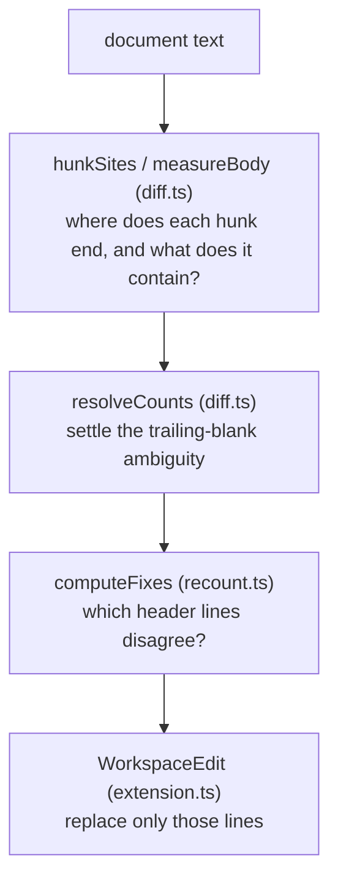

# Architecture

Hunky Dory watches patch files in the editor and rewrites `@@` hunk headers so
they agree with the body beneath them.

## Components

| Module | Responsibility |
|---|---|
| `src/diff.ts` | Parses hunk headers and counts body lines. Knows every counting rule. No vscode import. |
| `src/recount.ts` | Turns a document into the list of headers that are wrong. No vscode import. |
| `src/extension.ts` | Decides *when* to recount and applies the edits. All vscode contact lives here. |
| `test/recount.test.ts` | Unit tests for the rules. |
| `test/corpus.ts` | Round-trip check over the committed fixtures and a directory of real patches. |
| `test/scripts.test.ts` | Exercises the `tools/` release scripts' validation and failure paths, without docker. |
| `test/fixtures/` | Patches that must survive recounting untouched, covering what a real patch set does not contain. |
| `test/fuzz.ts`, `test/fuzz/` | Edits correct patches as a person might, recounts, and has git judge the result. |
| `test/editor/` | Undo, redo, and the editor's recount against `recountText`, in a real editor host; run by `tools/editor-test.sh` rather than `npm test`. |

The split matters: the interesting logic is pure string-to-string, so it runs
under a plain `node --test` without an editor host. Only scheduling and edit
application need vscode. What branching that layer has is about how edits
meet the editor's undo stack, which no plain node test can reach, so
`test/editor/` drives it in a real one.

## How data moves

`computeFixes` returns *only* the headers that need changing rather than a
whole rewritten document. That keeps the edit minimal, which is what stops the
user's cursor from jumping and keeps undo granular.

## Why a full recount rather than incremental tracking

An obvious optimisation is to watch `onDidChangeTextDocument`, work out which
hunk the edit landed in, and adjust only that hunk's counts. We do not, for two
reasons:

1. Patch files are small. A full recount of a few thousand lines is far below
   the 200ms debounce, so there is nothing to win.
2. A full recount reads the *existing* headers, and those headers are what
   resolve the trailing-blank ambiguity (see
   [docs/ambiguity.md](docs/ambiguity.md)). An incremental updater that never
   re-reads them would have to carry that state itself.

If profiling ever says otherwise, the seam is `computeFixes`: give it a line
range to limit itself to and propagate offsets from there.

## Editing loop safety

Applying a fix fires `onDidChangeTextDocument` again. Five things prevent a
loop or a fight with the user:

- An `applying` set suppresses reentry while our own edit is in flight.
- A debounce collapses a burst of keystrokes into one recount.
- The header the cursor is on is skipped in `live` mode, because rewriting the
  line someone is typing into is hostile. The explicit command ignores this.
- A live fix joins the undo step of the edit that prompted it
  (`undoStopBefore: false`), so one undo takes back the edit and its header
  together. As a step of its own, undo would revert the header first and the
  recount would put it straight back.
- An undo or redo never triggers a recount, and cancels one still pending.
  VS Code can close the user's undo step before the fix lands, and the
  explicit command always takes its own; this is what keeps undo working then.

On save the fixes go through `onWillSaveTextDocument`'s `waitUntil`, so they
land in the file being written rather than dirtying the buffer immediately
after a save.
